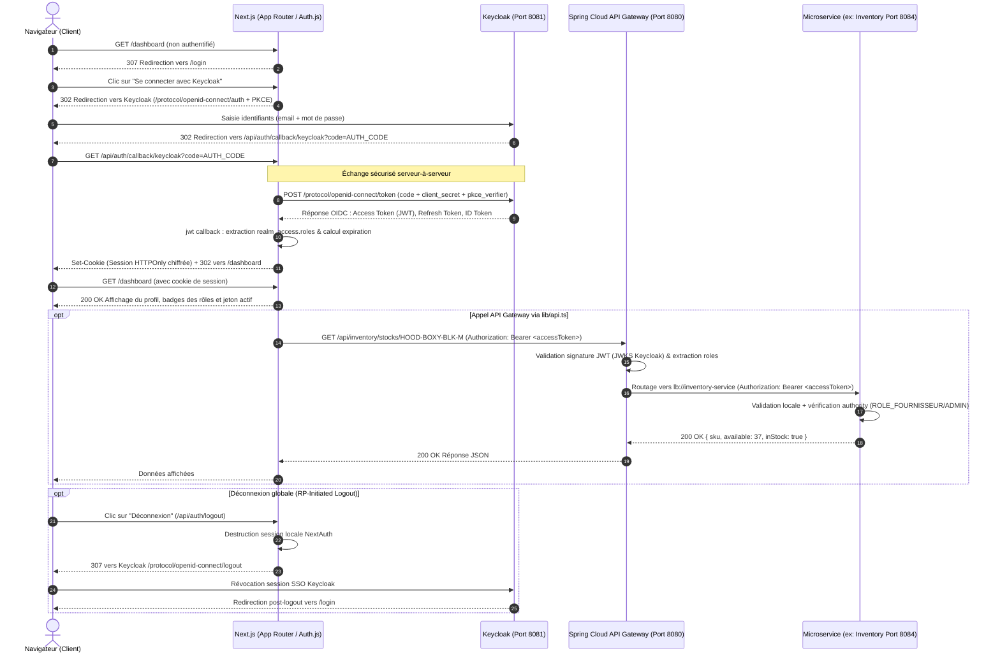

# DropFlow Hub &bull; Frontend & Authentification Keycloak OIDC

Application Frontend **Next.js 14+ (App Router, TypeScript strict)** pour la plateforme microservices **DropFlow Hub**. L'authentification et l'autorisation sont entièrement déléguées à **Keycloak** via le protocole **OpenID Connect (Authorization Code Flow avec PKCE S256)**.

---

## 1. Démarrage Rapide

### Prérequis
- Docker Desktop en cours d'exécution
- Node.js 18+ (testé sous v26.13) & npm

### Étape 1 : Démarrer le serveur Keycloak (Port 8081)
Depuis la racine du projet :
```bash
docker compose -f Infra/keycloak/docker-compose.yml up -d
```
> Le conteneur démarre et importe automatiquement le realm `dropflow` depuis `Infra/keycloak/dropflow-realm.json`.

### Étape 2 : Configurer les variables d'environnement
Le fichier `.env.local` est déjà préconfiguré pour le développement local. Vous pouvez vous baser sur `.env.example` :
```env
AUTH_SECRET=dropflow-auth-secret-change-in-production-32-chars-min
AUTH_TRUST_HOST=true
AUTH_KEYCLOAK_ID=dropflow-web
AUTH_KEYCLOAK_SECRET=dropflow-web-secret-key-2026
AUTH_KEYCLOAK_ISSUER=http://localhost:8081/realms/dropflow
NEXT_PUBLIC_GATEWAY_URL=http://localhost:8080
```

### Étape 3 : Installer les dépendances et lancer l'application
```bash
cd Frontend
npm install
npm run dev
```
Ouvrez [http://localhost:3000](http://localhost:3000) dans votre navigateur.

---

## 2. Configuration Keycloak

Le serveur Keycloak s'exécute sur le port **8081** (`http://localhost:8081`) pour ne pas entrer en conflit avec les autres services du cluster (API Gateway sur le port 8080).

### Paramètres du Realm et Client
- **Realm :** `dropflow`
- **Client :** `dropflow-web`
  - **Type de client :** Confidentiel (`clientAuthenticatorType: client-secret`)
  - **Flux :** Standard Flow (Authorization Code) activé avec PKCE S256
  - **URI de redirection valide :** `http://localhost:3000/api/auth/callback/keycloak`
  - **Origine Web :** `http://localhost:3000`
  - **Post-logout redirect URI :** `http://localhost:3000`

### Emplacements des captures d'écran (Screenshots Placeholders)
Pour le rapport de validation et la documentation projet, voici les captures recommandées de la console Keycloak :


*Figure 1 : Vue d'ensemble du Realm DropFlow (port 8081).*


*Figure 2 : Paramétrage du client confidentiel dropflow-web et des URIs de redirection.*


*Figure 3 : Liste des 7 rôles métier DropFlow dans Keycloak.*


*Figure 4 : Comptes de test préconfigurés avec rôles et identifiants.*

---

## 3. Comptes de Test Préconfigurés

Chaque utilisateur est initialisé avec un mot de passe dev non temporaire et le rôle correspondant inclus dans `realm_access.roles` :

| Rôle | Email / Identifiant | Mot de passe | Périmètre fonctionnel |
| :--- | :--- | :--- | :--- |
| **`ADMIN`** | `admin@dropflow.com` | `admin123` | Accès complet, supervision microservices, `/admin` |
| **`ECOMMERCANT`** | `ecom@dropflow.com` | `ecom123` | Gestion des ventes, catalogue, commandes |
| **`FOURNISSEUR`** | `fournisseur@dropflow.com` | `fournisseur123` | Gestion des stocks, approvisionnements |
| **`AGENT_CONFIRMATION`** | `confirmation@dropflow.com` | `confirm123` | Validation téléphonique et contrôle des commandes |
| **`AGENT_LOGISTIQUE`** | `logistique@dropflow.com` | `logistics123` | Préparation colis, expéditions entrepôt |
| **`AGENT_FINANCIER`** | `financier@dropflow.com` | `finance123` | Suivi des règlements et facturation |
| **`AGENT_SUPPORT`** | `support@dropflow.com` | `support123` | Gestion des tickets, litiges et réclamations |

---

## 4. Diagramme de Séquence du Flux d'Authentification



---

## 5. Architecture Côté Frontend

1. **`auth.ts` :** Configuration d'Auth.js v5 avec le fournisseur Keycloak :
   - `jwt` callback : extrait `accessToken`, `refreshToken`, `expiresAt`, et parse les rôles depuis `realm_access.roles` du payload JWT.
   - **Rafraîchissement automatique :** Dès que le jeton arrive à expiration (avec marge de sécurité de 10s), une requête POST vers le `token_endpoint` de Keycloak avec `grant_type: refresh_token` renouvelle le jeton de manière transparente sans déconnecter l'utilisateur.
   - `session` callback : expose `session.accessToken`, `session.roles` et `session.error`.
2. **`middleware.ts` :** Intercepte chaque requête vers les routes applicatives :
   - Redirige les utilisateurs non authentifiés vers `/login`.
   - Redirige les utilisateurs déjà authentifiés depuis `/login` vers `/dashboard`.
   - Applique le **RBAC** : la route `/admin` est strictement réservée au rôle `ADMIN`. Un utilisateur sans ce rôle est dirigé vers `/unauthorized?required=ADMIN`.
3. **`types/next-auth.d.ts` :** Augmentation des types TypeScript pour `Session` et `JWT`.
4. **`app/api/auth/logout/route.ts` :** Gestion de la fin de session Keycloak OIDC (RP-Initiated Logout).
5. **`lib/api.ts` :** Helper `apiFetch` injectant systématiquement `Authorization: Bearer <accessToken>` pour tous les appels vers la Gateway.

---

## 6. Note d'Intégration Backend (Spring Cloud & Microservices)

> **Note :** Cette section est documentaire conformément aux consignes du projet.

Pour que la **Spring Cloud Gateway** et chaque microservice (ex: `user-service`, `inventory-service`, `order-service`) valident le jeton émis par Keycloak :

### Dépendance Maven (dans chaque `pom.xml`)
```xml
<dependency>
    <groupId>org.springframework.boot</groupId>
    <artifactId>spring-boot-starter-oauth2-resource-server</artifactId>
</dependency>
```

### Configuration Spring Cloud (`application.yml` ou Config Server)
```yaml
spring:
  security:
    oauth2:
      resourceserver:
        jwt:
          issuer-uri: http://localhost:8081/realms/dropflow
          jwk-set-uri: http://localhost:8081/realms/dropflow/protocol/openid-connect/certs
```

### Convertisseur de Rôles Keycloak vers Spring Authorities (`SecurityConfig.java`)
Keycloak place les rôles dans le claim `realm_access.roles`. Par défaut, Spring Security recherche le claim `scope` ou `scp`. Il convient d'enregistrer un `JwtAuthenticationConverter` personnalisé :

```java
@Configuration
@EnableWebSecurity
@EnableMethodSecurity(prePostEnabled = true)
public class SecurityConfig {

    @Bean
    public SecurityFilterChain securityFilterChain(HttpSecurity http) throws Exception {
        http
            .csrf(csrf -> csrf.disable())
            .authorizeHttpRequests(auth -> auth
                .requestMatchers("/actuator/**", "/public/**").permitAll()
                .requestMatchers("/api/admin/**").hasRole("ADMIN")
                .requestMatchers("/api/inventory/**").hasAnyRole("ADMIN", "FOURNISSEUR", "AGENT_LOGISTIQUE")
                .anyRequest().authenticated()
            )
            .oauth2ResourceServer(oauth2 -> oauth2
                .jwt(jwt -> jwt.jwtAuthenticationConverter(jwtAuthenticationConverter()))
            );
        return http.build();
    }

    @Bean
    public JwtAuthenticationConverter jwtAuthenticationConverter() {
        JwtAuthenticationConverter converter = new JwtAuthenticationConverter();
        converter.setJwtGrantedAuthoritiesConverter(jwt -> {
            Map<String, Object> realmAccess = jwt.getClaim("realm_access");
            if (realmAccess == null || !realmAccess.containsKey("roles")) {
                return Collections.emptyList();
            }
            @SuppressWarnings("unchecked")
            List<String> roles = (List<String>) realmAccess.get("roles");
            return roles.stream()
                .map(role -> new SimpleGrantedAuthority("ROLE_" + role))
                .collect(Collectors.toList());
        });
        return converter;
    }
}
```

---

## 7. Sécurité & Bonnes Pratiques

- **Aucun secret dans le code :** Les identifiants sensibles (`AUTH_SECRET`, `AUTH_KEYCLOAK_SECRET`) sont stockés dans `.env.local` et exclus de git via `.gitignore`.
- **Jamais de token dans les URLs ou logs :** L'Authorization Code Flow utilise un échange serveur-à-serveur pour les jetons. Le token est stocké dans un cookie chiffré (`HTTPOnly`, `SameSite=Lax`).
- **Protection PKCE S256 :** Empêche toute interception du code d'autorisation par un tiers.
